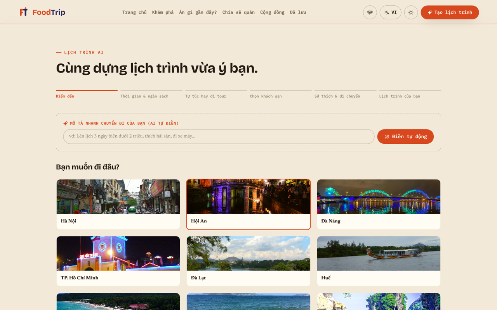
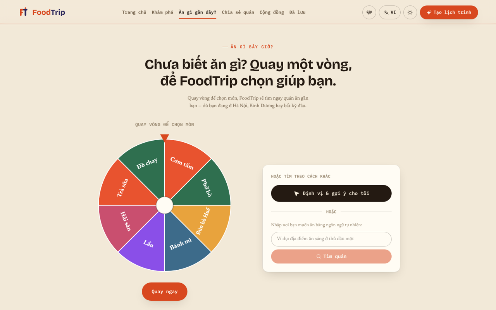
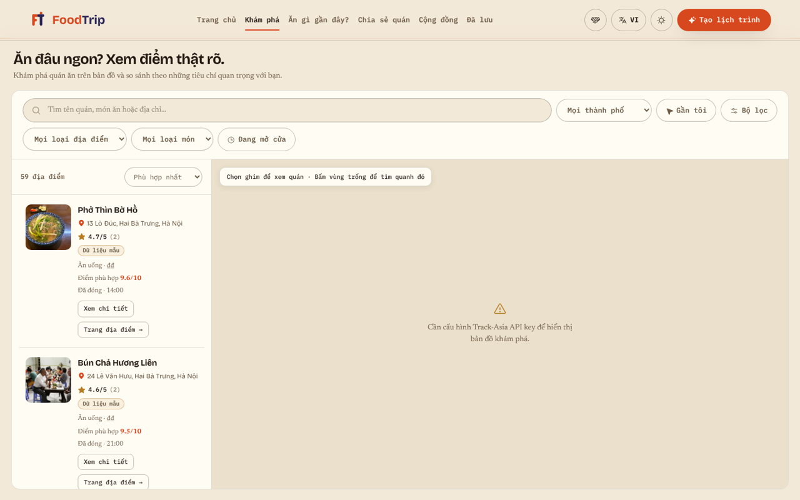

<div align="center">

# 🍜 FoodTrip

**Nền tảng lên lịch trình du lịch ẩm thực Việt Nam, có AI hỗ trợ**

*Đồ án tốt nghiệp*


</div>

---

## 📖 Giới thiệu

**FoodTrip** giúp người dùng lên kế hoạch cho một chuyến đi xoay quanh ẩm thực. Người dùng chỉ cần chọn điểm đến, thời gian, ngân sách và sở thích, hoặc **gõ một câu mô tả** như *"3 ngày ở Hội An dưới 2 triệu, thích hải sản"*. Hệ thống sẽ tự dựng lịch trình theo từng ngày: sáng ăn gì, trưa tham quan đâu, tối đi dạo chỗ nào. Sau đó người dùng có thể đặt phòng khách sạn, đặt tour và chia sẻ trải nghiệm với cộng đồng.

Dự án bao phủ trọn vòng đời sản phẩm: **phân tích yêu cầu → thiết kế → xây dựng → kiểm thử**. Hệ thống phục vụ 4 nhóm người dùng: du khách, đối tác khách sạn, đơn vị tổ chức tour và quản trị viên.

---

## ✨ Tính năng chính

| Nhóm | Tính năng |
|---|---|
| 🗺️ **Lập lịch trình AI** | Wizard 6 bước, hoặc mô tả chuyến đi bằng ngôn ngữ tự nhiên để AI tự điền. Hệ thống dựng lịch trình theo khung giờ và chỉ gợi ý những nơi còn mở cửa ở khung giờ đó |
| 📊 **Chấm điểm địa điểm** | Mô hình **Weighted Sum**: `0.30×Sở thích + 0.25×Đánh giá + 0.20×Khoảng cách + 0.15×Ngân sách + 0.10×Độ phổ biến` |
| 🧭 **Tối ưu tuyến đường** | Tối ưu thứ tự điểm đến trong ngày, coi như bài toán **TSP có ràng buộc khung giờ** (TSP with Time Windows), dựa trên khoảng cách đường bộ thực tế |
| 🔎 **Khám phá** | Bản đồ quán ăn và địa điểm tại 12 thành phố, lọc theo loại món, giờ mở cửa, khoảng cách. Có xem 360° Street View |
| 🎡 **Ăn gì bây giờ?** | Vòng quay chọn món, sau đó định vị và tìm quán gần nhất |
| 🎬 **Video review** | Tự tìm video YouTube Shorts / TikTok review cho từng quán |
| 🏨 **Đặt phòng & tour** | Xem giá phòng thực tế (Hotelbeds), quản lý tồn phòng, thanh toán qua **VNPay** / **SePay** |
| 🤝 **Đối tác** | Khách sạn và đơn vị tour tự đăng ký, đăng phòng, đăng tour, quản lý đơn |
| 👥 **Cộng đồng** | Đăng bài kèm ảnh và vị trí trên bản đồ, bình luận |
| 📍 **Chuyến đi trực tiếp** | Chia sẻ lịch trình qua link, phòng realtime để cả nhóm cùng theo dõi hành trình |
| 🛡️ **Quản trị** | Quản lý người dùng, đơn đặt chỗ, bài viết, bình luận, video review và liên hệ |
| 🌐 **Đa ngôn ngữ** | Tiếng Việt / English, giao diện sáng / tối |

---

## 🖼️ Giao diện

**Lập lịch trình**



**Ăn gì bây giờ? (vòng quay chọn món)**



**Khám phá quán ăn**



---

## 🏗️ Kiến trúc

```
┌─────────────────────┐      ┌──────────────────────────────────────┐
│  React 19 + Vite    │      │  Supabase                            │
│  (SPA, 22 trang)    │◄────►│  • PostgreSQL + Row Level Security   │
│                     │      │  • Auth, Storage, Realtime           │
│  MapLibre GL        │      │  • 20 Edge Functions (Deno)          │
└─────────┬───────────┘      └───────────────┬──────────────────────┘
          │                                  │
          ▼                                  ▼
   Track-Asia (bản đồ,              Claude API · Google Places · YouTube Data
   tìm kiếm, chỉ đường)             Hotelbeds · VNPay · SePay
```

- **Frontend:** React 19, React Router 7, Tailwind CSS 4, Framer Motion, MapLibre GL, Pannellum (ảnh 360°)
- **Backend:** Supabase gồm PostgreSQL với **29 migration**, RLS cho mọi bảng và **20 Edge Functions**
- **AI / NLP:**
  - Claude API phân tích yêu cầu chuyến đi viết bằng tiếng Việt
  - Bộ dữ liệu NER tiếng Việt (~3.000 câu, nhãn `BUSINESS` / `LOC`) cùng notebook huấn luyện **PhoBERT** để nhận diện tên quán và địa danh trong phụ đề video
- **Tích hợp:** Track-Asia, Google Places, YouTube Data API, Hotelbeds, VNPay (sandbox), SePay

---

## 🗂️ Cấu trúc thư mục

```
src/
├── pages/            # Các trang: Landing, Planner, Explore, Community, Booking, Admin, Partner...
├── components/       # UI theo module: map, planner, booking, tours, community, video...
├── lib/              # Nghiệp vụ: itineraryEngine, placeScore, routeOptimizer, pricing, bookings...
├── hooks/            # Custom hooks (live navigation, theme, place enrichment...)
├── data/             # Dữ liệu mẫu 12 thành phố
└── i18n/             # Đa ngôn ngữ VI / EN
supabase/
├── migrations/       # 29 file migration (schema, RLS, booking, tour, partner...)
└── functions/        # 20 Edge Functions (parse-trip-request, hotel-availability, vnpay-*, sepay-*...)
ml/                   # Bộ dữ liệu NER + notebook huấn luyện PhoBERT
scripts/              # Script thu thập dữ liệu địa điểm, phụ đề YouTube
test/                 # Kiểm thử (node --test) và tài liệu kiểm thử
```

---

## 🚀 Cài đặt và chạy

```bash
git clone https://github.com/Hieutrinh04/FoodTrip.git
cd FoodTrip
npm install
cp .env.example .env.local   # điền các API key cần thiết
npm run dev                  # http://localhost:5173
```

Thiếu API key thì ứng dụng vẫn chạy với dữ liệu mẫu, nhưng một số tính năng sẽ bị tắt (bản đồ, giá phòng thật, thanh toán). Hướng dẫn chi tiết cho từng key có trong [`.env.example`](.env.example).

| Lệnh | Mục đích |
|---|---|
| `npm run dev` | Chạy môi trường phát triển |
| `npm run build` | Build bản production |
| `npm test` | Chạy kiểm thử |
| `npm run lint` | Kiểm tra mã nguồn |

---

## 👤 Tác giả

**Trịnh Minh Hiếu** · [GitHub](https://github.com/Hieutrinh04)
