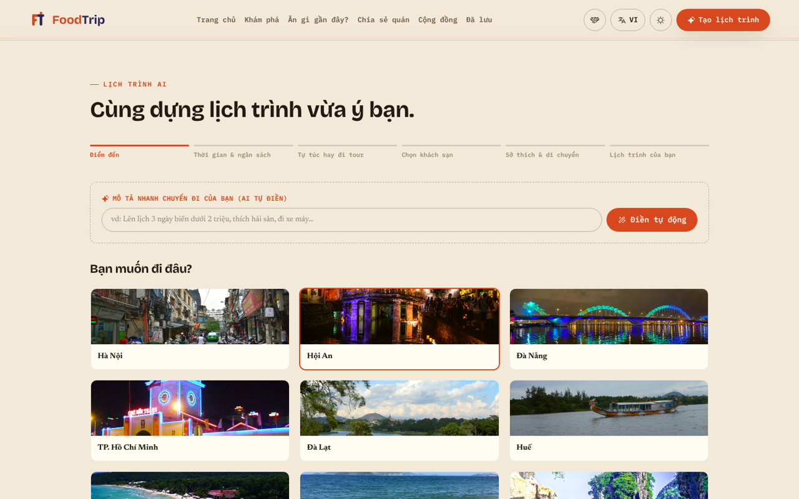
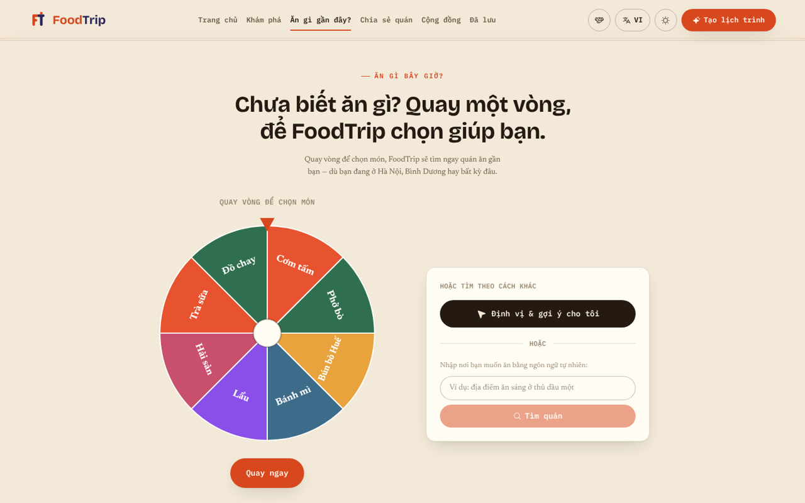
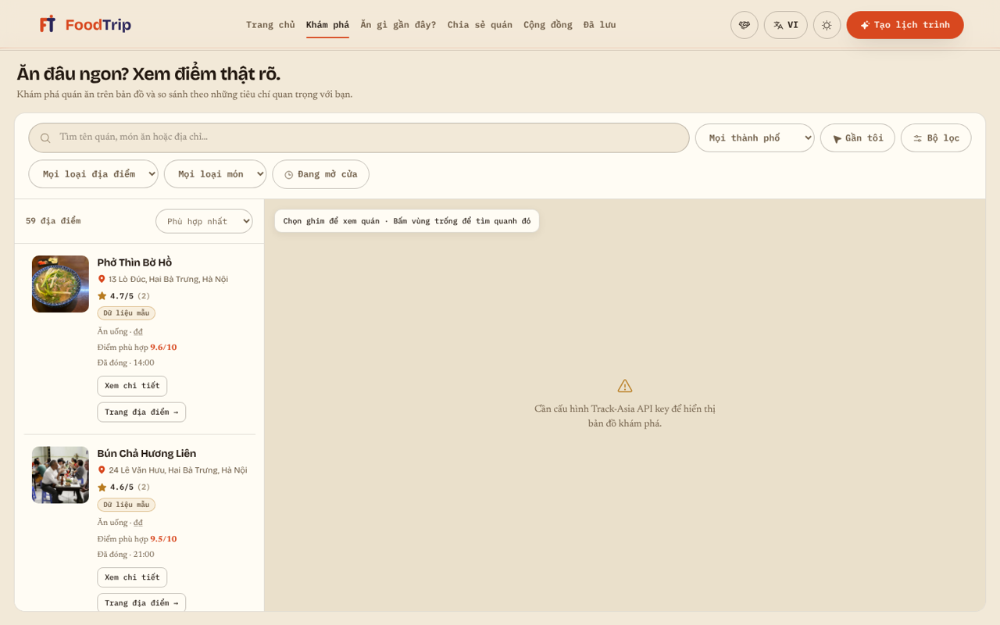

<div align="center">

# 🍜 FoodTrip

**Nền tảng khám phá địa điểm và lên lịch trình du lịch ẩm thực Việt Nam**

*Đồ án tốt nghiệp*


</div>

---

## 📖 Giới thiệu

**FoodTrip** giúp người dùng lên kế hoạch cho một chuyến đi xoay quanh ẩm thực. Người dùng chỉ cần chọn điểm đến, thời gian, ngân sách và sở thích, hoặc **gõ một câu mô tả** như *"3 ngày ở Hội An dưới 2 triệu, thích hải sản"*. Hệ thống sẽ tự dựng lịch trình theo từng ngày: sáng ăn gì, trưa tham quan đâu, tối đi dạo chỗ nào. Sau đó người dùng có thể đặt phòng khách sạn, đặt tour và chia sẻ trải nghiệm với cộng đồng.

Dự án bao phủ trọn vòng đời sản phẩm: **phân tích yêu cầu → thiết kế → xây dựng → kiểm thử**. Hệ thống phục vụ 4 nhóm người dùng: du khách, đối tác khách sạn, đơn vị tổ chức tour và quản trị viên.

---

## ✨ Tính năng chính

| Nhóm | Tính năng |
|---|---|
| 🗺️ **Lập lịch trình** | Wizard 6 bước, hoặc mô tả chuyến đi để bộ đọc cục bộ gợi ý điền thông tin. Hệ thống dựng lịch trình theo khung giờ và dùng giờ mở cửa khi có dữ liệu; người dùng cần xác nhận lại trước khi đi |
| 📊 **Chấm điểm địa điểm** | Mô hình **Weighted Sum**: `0.30×Sở thích + 0.25×Đánh giá + 0.20×Khoảng cách + 0.15×Ngân sách + 0.10×Độ phổ biến` |
| 🧭 **Tối ưu tuyến đường** | Tối ưu thứ tự điểm đến trong ngày, coi như bài toán **TSP có ràng buộc khung giờ** (TSP with Time Windows), dựa trên khoảng cách đường bộ thực tế |
| 🔎 **Khám phá** | Bản đồ quán ăn và địa điểm tại 12 thành phố, lọc theo loại món, giờ mở cửa, khoảng cách. Có xem 360° Street View |
| 🎡 **Ăn gì bây giờ?** | Vòng quay chọn món, sau đó định vị và tìm quán gần nhất |
| 🎬 **Video review** | Tự tìm video YouTube Shorts / TikTok review cho từng quán |
| 🏨 **Đặt phòng & tour** | Giá Hotelbeds là tham khảo từ môi trường thử nghiệm, chưa phải giá đặt được. Đối tác quản lý tồn phòng; luồng VNPay / SePay hỗ trợ chế độ thử theo cấu hình |
| 🤝 **Đối tác** | Khách sạn và đơn vị tour tự đăng ký, đăng phòng, đăng tour, quản lý đơn |
| 👥 **Cộng đồng** | Đăng bài kèm ảnh và vị trí trên bản đồ, bình luận |
| 📍 **Chuyến đi trực tiếp** | Chia sẻ lịch trình qua link, phòng realtime để cả nhóm cùng theo dõi hành trình |
| 🛡️ **Quản trị** | Quản lý người dùng, đơn đặt chỗ, bài viết, bình luận, video review và liên hệ |
| 🌐 **Đa ngôn ngữ** | Tiếng Việt / English, giao diện sáng / tối |

---

## 🖼️ Giao diện

**Lập lịch trình**



**Ăn gì bây giờ? (vòng quay chọn món)**



**Khám phá quán ăn**



---

## 🏗️ Kiến trúc

```
┌─────────────────────┐      ┌──────────────────────────────────────┐
│  React 19 + Vite    │      │  Supabase                            │
│  (SPA, 25 module trang)    │◄────►│  • PostgreSQL + Row Level Security   │
│                     │      │  • Auth, Storage, Realtime           │
│  MapLibre GL        │      │  • 22 Edge Functions (Deno)          │
└─────────┬───────────┘      └───────────────┬──────────────────────┘
          │                                  │
          ▼                                  ▼
   Track-Asia (bản đồ,              Google Places · YouTube Data (Claude tuỳ chọn)
   tìm kiếm, chỉ đường)             Hotelbeds · VNPay · SePay
```

- **Frontend:** React 19, React Router 7, Tailwind CSS 4, Framer Motion, MapLibre GL, Pannellum (ảnh 360°)
- **Backend:** Supabase gồm PostgreSQL với **47 migration**, RLS cho mọi bảng và **22 Edge Functions**
- **AI / NLP:**
  - Trợ lý hiện xử lý bằng quy tắc, FAQ và dữ liệu ứng dụng. Theo lần kiểm tra server đã ghi nhận: khóa Anthropic chưa cấu hình, mô hình tự train chưa triển khai. Việc có code tích hợp không có nghĩa mô hình đang chạy.
  - Mục tiêu huấn luyện trợ lý là **PhoBERT intent + BIO slots** và bộ tìm FAQ (`ml/assistant`); notebook và tập dữ liệu đã có, chưa có xác nhận triển khai trọng số. Pipeline NER tên quán/địa danh trong phụ đề video là phần riêng (`ml/training`). Phần thử fine-tune sinh câu trả lời chưa được bật trên web.
- **Tích hợp:** Track-Asia, Google Places, YouTube Data API, Hotelbeds, VNPay (sandbox), SePay

---

## 🗂️ Cấu trúc thư mục

```
src/
├── pages/            # Các trang: Landing, Planner, Explore, Community, Booking, Admin, Partner...
├── components/       # UI theo module: map, planner, booking, tours, community, video...
├── lib/              # Nghiệp vụ: itineraryEngine, placeScore, routeOptimizer, pricing, bookings...
├── hooks/            # Custom hooks (live navigation, theme, place enrichment...)
├── data/             # Dữ liệu mẫu 12 thành phố
└── i18n/             # Đa ngôn ngữ VI / EN
supabase/
├── migrations/       # 47 file migration (schema, RLS, booking, tour, partner...)
└── functions/        # 22 Edge Functions (parse-trip-request, hotel-availability, vnpay-*, sepay-*...)
ml/                   # Trợ lý PhoBERT intent + slots, FAQ và pipeline NER video riêng
scripts/              # Script thu thập dữ liệu địa điểm, phụ đề YouTube
test/                 # Kiểm thử (node --test) và tài liệu kiểm thử
```

---

## 🚀 Cài đặt và chạy

```bash
git clone https://github.com/Hieutrinh04/FoodTrip.git
cd FoodTrip
npm install
cp .env.example .env.local   # điền các API key cần thiết
npm run dev                  # http://localhost:5173
```

Thiếu API key thì ứng dụng vẫn chạy với dữ liệu mẫu, nhưng một số tính năng sẽ bị tắt (bản đồ, giá tham khảo nhà cung cấp, thanh toán). Hướng dẫn chi tiết cho từng key có trong [`.env.example`](.env.example).

| Lệnh | Mục đích |
|---|---|
| `npm run dev` | Chạy môi trường phát triển |
| `npm run build` | Build bản production |
| `npm test` | Chạy kiểm thử |
| `npm run lint` | Kiểm tra mã nguồn |

---

## 👤 Tác giả

**Trịnh Minh Hiếu** · [GitHub](https://github.com/Hieutrinh04)
